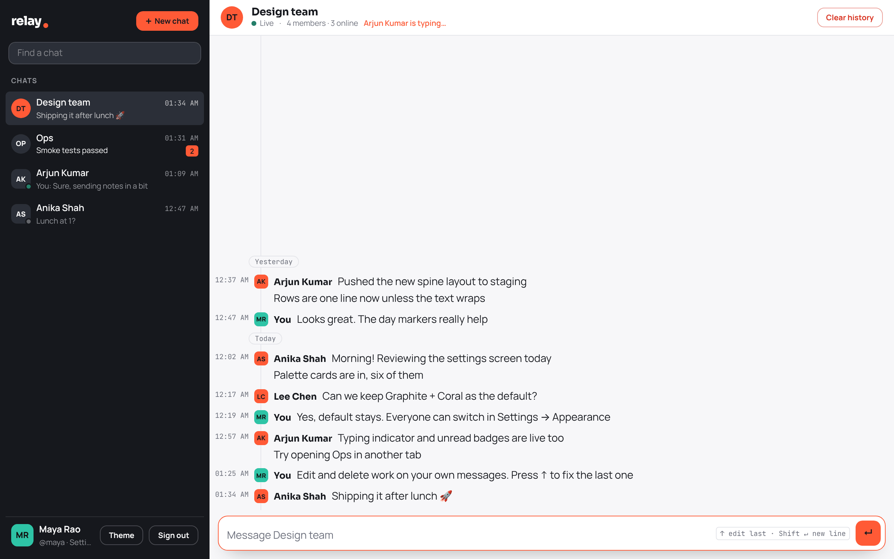
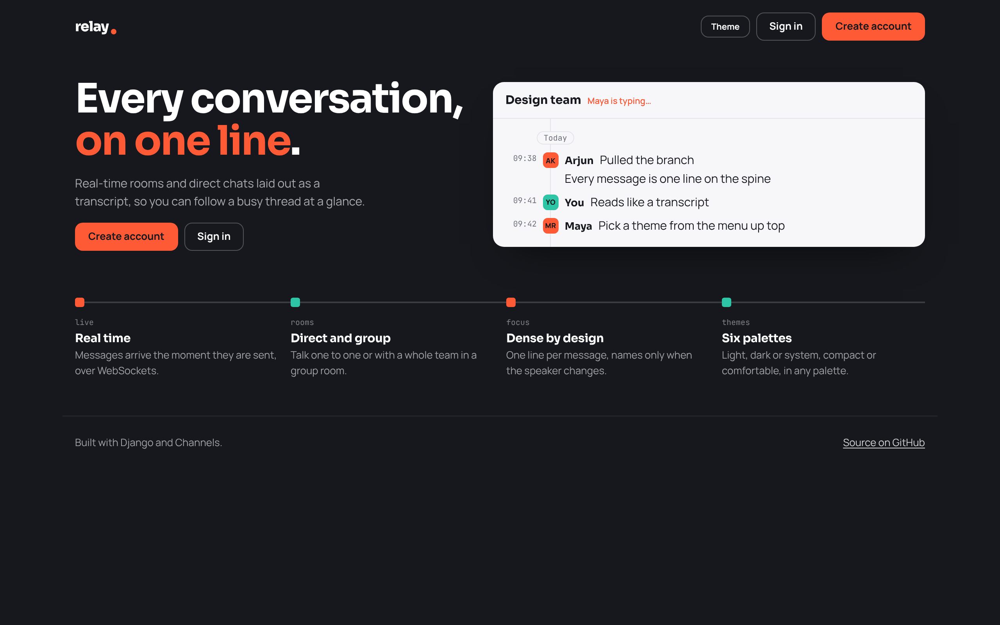
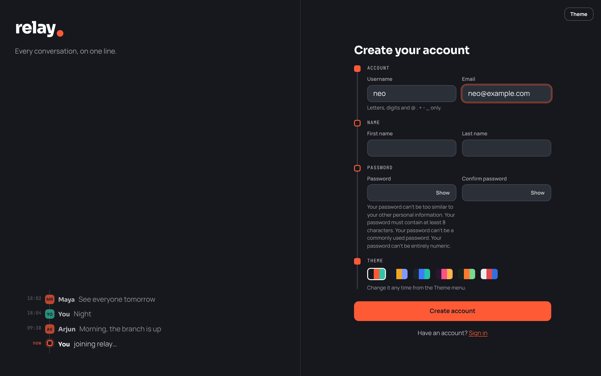
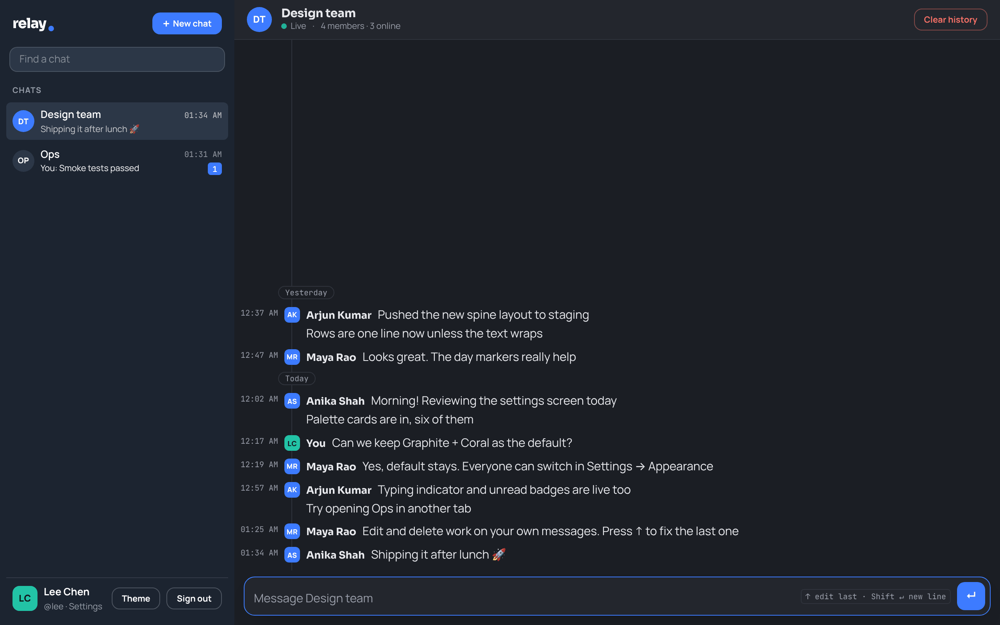
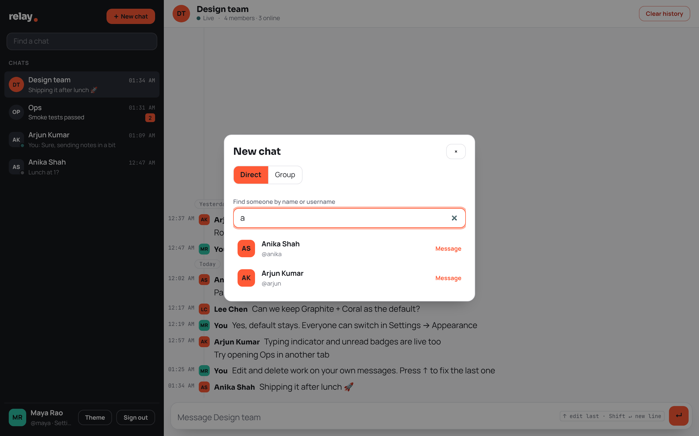
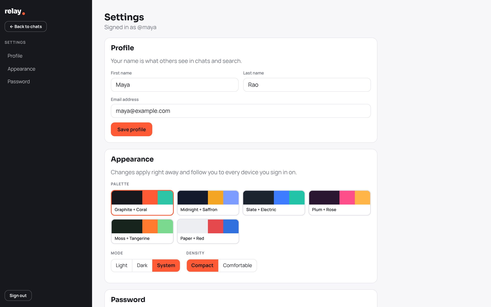
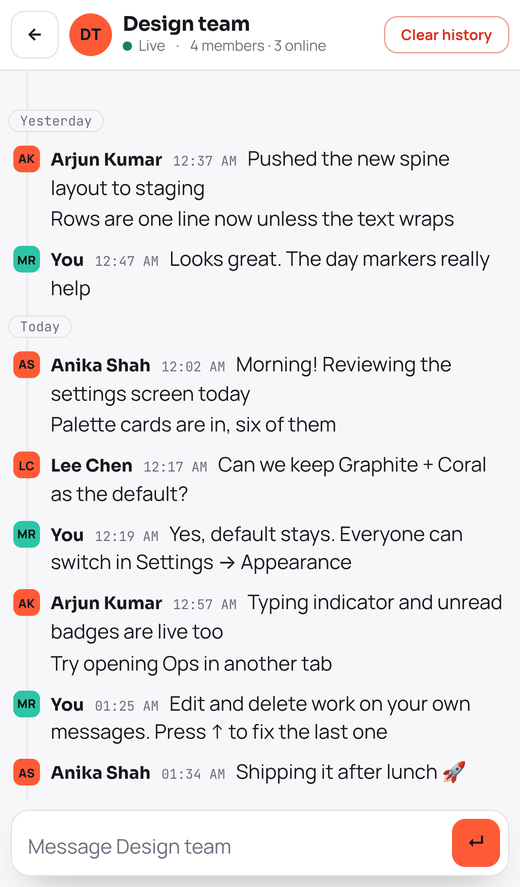
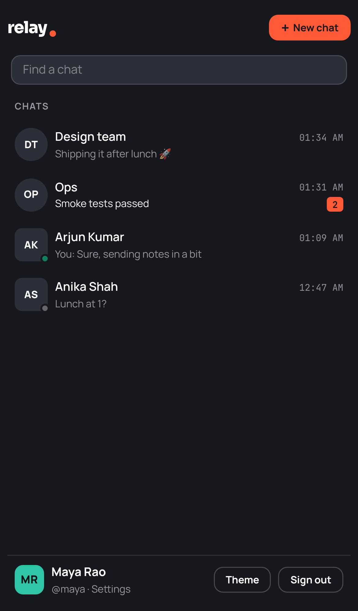

# Relay · Django Real-Time Chat

A real-time chat app built with Django and Django Channels. Conversations read
like a transcript: one line per message on a vertical spine, with names only
when the speaker changes.



## Features

- **Direct and group chats**: search people by name or username, reuse an
  existing direct chat, or name a group and add members.
- **Live messaging** over WebSockets with automatic reconnect and a connection
  status in the header.
- **Edit and delete** your own messages; press ↑ in an empty composer to edit
  the last one.
- **Infinite scroll** through history, 50 messages at a time.
- **Presence, typing and unread**: online dots, "… is typing…", per-room unread
  badges and a count in the tab title.
- **Themes**: six palettes, light/dark/system mode and compact/comfortable
  density, saved to your account so they follow you across devices.
- **Responsive**: full sidebar on desktop, icon rail on tablets, one pane at a
  time on phones.
- **Accessible**: keyboard focus everywhere, labelled controls, reduced-motion
  support.

| | |
| --- | --- |
|  |  |
|  |  |
|  |   |

## Quick start

```sh
python -m venv .venv && source .venv/bin/activate
pip install -r requirements-dev.txt
cp .env.example .env
python manage.py migrate
python manage.py runserver
```

Open http://localhost:8000, create an account, then use **New chat** to
message someone or start a group. Open a second browser (or a private window)
with another account to see messages, typing and presence live.

With Docker: `docker compose up --build` (includes Redis). In debug mode it
also loads [demo data](./docs/demo-data.md): sign in as `maya` with password
`relay-demo-123`. Without Docker, run `python manage.py seed_demo`.

## Stack

| Part | Version |
| --- | --- |
| Python | 3.12, 3.13 |
| Django | 5.2 LTS |
| Channels / Daphne | 4.x |
| Channel layer | In-memory by default, Redis when `REDIS_URL` is set |
| Database | SQLite (any Django database works) |
| Front end | Plain CSS and JavaScript, no build step |

## Documentation

Start with the [documentation index](./docs/README.md).

- [Setup](./docs/setup.md): local, Docker, environment variables, production notes
- [Architecture](./docs/architecture.md): how the pieces fit together, security model
- [Screens and URLs](./docs/screens.md): every page and endpoint
- [WebSocket protocol](./docs/websocket-protocol.md): room and inbox sockets
- [Data model](./docs/data-model.md): rooms, messages, read state, presence, preferences
- [Design system](./docs/design-system.md): Signal tokens, palettes, components
- [Demo data](./docs/demo-data.md): sample users, chats and sign-in details
- [Testing](./docs/testing.md): running the suite, CI
- [Claude Code agents](./docs/agents.md): design, code review, user testing and planning agents
- [Contributing](./CONTRIBUTING.md): branches, commits, checks, what to update
- [Changelog](./CHANGELOG.md)

Background notes: [Channels setup][config_channels.md],
[channel layers][config_channel_layers.md], [static files][config_static_files.md].

## Project layout

```
account/            sign in, create account, sign out, settings, Preference model
chat/               rooms, messages, chat screen, starting chats, history
chat/channels/      ChatConsumer (one room) and InboxConsumer (presence, activity)
chat/presence.py    online status and unread counts
core/               design system, base template, home page, error pages
realtime_chat/      settings, URL and WebSocket routing, ASGI/WSGI
docs/               documentation and screenshots
.claude/agents/     Claude Code subagents (design, review, testing, planning)
readme/             background notes on Channels and static files
```

## License

See [LICENSE](./LICENSE).

<!-- File links -->
[config_channels.md]: ./readme/config_channels.md
[config_static_files.md]: ./readme/config_static_files.md
[config_channel_layers.md]: ./readme/config_channel_layers.md
