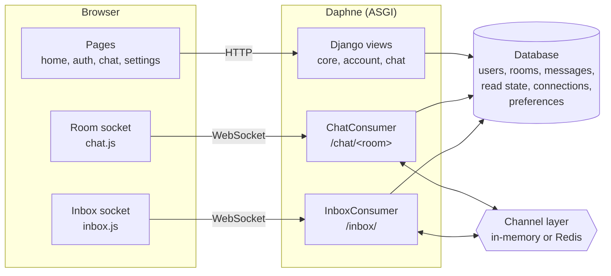
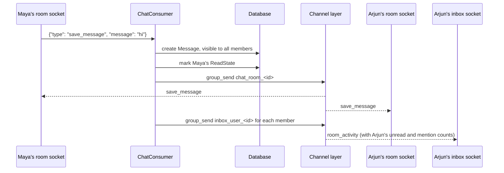

# Architecture

Relay is one Django project served by Daphne (ASGI). Ordinary page requests
go through Django views; live features go through two Channels WebSocket
consumers. All state lives in the database; the channel layer only carries
messages between processes.

## Apps

| App | Responsibility | Key files |
| --- | --- | --- |
| `core` | Design system, base template, theme options, home page, error pages, style guide | `theme.py`, `context_processors.py`, `static/core/`, `templates/core/` |
| `account` | Sign in, create account, sign out, settings, saved appearance | `forms.py`, `views.py`, `models.py` (`Preference`) |
| `chat` | Rooms, messages, chat screen, starting chats, history, presence, unread | `models.py`, `views.py`, `services.py`, `presenters.py`, `presence.py`, `channels/consumers.py` |
| `realtime_chat` | Settings, URL and WebSocket routing, ASGI/WSGI entry points | `settings.py`, `urls.py`, `asgi.py` |

Inside `chat`, each module has one job:

| Module | Job |
| --- | --- |
| `services.py` | Create rooms: people search, direct chats, groups |
| `groups.py` | Group rules: add, remove, rename, admins, leave, delete; writes group events |
| `live_rooms.py` | After a commit, tell each affected person's inbox sockets that a room was added, changed, removed or needs a refresh. `room_changed` is one frame for every member; `room_added` summaries for any number of people are built with a fixed number of queries. A failed send is skipped and logged once per action (frame type, room id, failed user ids, count), so it never breaks the request |
| `realtime.py` | Channel layer group names and helpers for sending to room and inbox sockets from views. The `*_after_commit` helpers queue room events until the transaction commits, keep their order, send nothing on rollback, and log failed sends |
| `reactions.py` | Reactions: check and save a `react` frame (`set_reaction`), the per-user rate limit (`rate_limited`), and who gets `reactions_updated` (current members who can still see the message) |
| `mentions.py` | Mentions: find the members a text names (`find_mentions`), make a message's `Mention` rows match (`sync_mentions`) and remove them on delete (`clear_mentions`); rows record the text, and every "for you" reader filters by `visible_for` |
| `presenters.py` | Turn rooms and messages into plain data for templates, JSON and sockets, including every message's `reactions` and `mentions` lists |
| `presence.py` | Online status (`Connection`), and unread and mention counts (`ReadState`) |
| `views.py` | HTTP: chat page, people search, start chats, history pages, Details panel, group actions |
| `channels/consumers.py` | WebSockets: `ChatConsumer` (one room) and `InboxConsumer` (everything else) |

## Request flow

### Opening a room

1. `GET /chat/?room=<uuid>` checks membership, marks the room
   read and renders the page with the latest 50 messages and the room list
   (previews, unread counts) embedded as JSON. A room you can't open
   redirects to `/chat/` with the same notice whether it's unknown, deleted
   or you're not a member.
2. `chat.js` draws the transcript from that JSON, then opens the room socket.
   `inbox.js` opens the inbox socket.
3. Scrolling to the top fetches `GET /chat/rooms/<uuid>/messages/?before=…`.

### Sending a message

Edits and deletes follow the same path and broadcast `message_updated`,
then send `room_refresh` to the inboxes of the same people.

### Replies

A `save_message` frame with `reply_to` is a reply. `ChatConsumer.reply_target`
looks the original up inside the same transaction as the insert: it must be
in this room, a text message, not deleted and visible to the sender. Any other
value raises `CantReply`, and the sender gets the one fixed error "You can't
reply to that message". If the original is removed from the database between
the check and the commit, the foreign key fails, the reply isn't saved and the
sender gets the same error.

`send_message_frame` sends a reply, and later edits or deletes of it, in up
to two group sends: one query finds which recipients can see the original,
those get the full quote, and the rest get only `{"id", "available": false}`.
The inbox `room_activity` frame always carries `"reply_to": null`.

History pages (`views.history_page`, used by the chat page and
`GET /chat/rooms/<uuid>/messages/`) take three queries per page however many
messages are replies or have reactions or mentions. The first loads the messages: the
original and its author are joined in with
`select_related("user", "reply_to__user")`, `.only(...)` limits the columns
to what `message_data` reads (no password hashes or other user fields), and
an `Exists` on the original's `visible_for` rows (same room only) is
annotated as `reply_visible`. `message_data` treats a missing annotation as
"can't see", so nothing leaks by default. The second,
`presenters.reactions_for_messages`, loads every reaction on the page's text
messages as plain tuples (message id, emoji, username, first and last name)
and groups them in Python; it is skipped when the page has no text messages
that aren't deleted. The third, `presenters.mentions_for_messages`, loads
every mention on the page with the person's username and name, and puts each
message's list in the order the text names them. Typing events go only to the
room group. See
[websocket-protocol.md](./websocket-protocol.md) for every frame.

### Reactions

A `react` frame goes to `ChatConsumer.handle_react`, which first checks the
rate limit and then calls `chat/reactions.py: set_reaction`:

1. The frame's `id`, `emoji` and `on` are checked before any query. Anything
   wrong raises `CantReact`, and the sender gets the one fixed error "You
   can't react to that message".
2. Reads alone settle refusals and no-ops: the message must be in this room,
   a text message, not deleted and visible to the sender, and if the
   reaction is already as asked, the sender's socket gets the current state
   and nothing is written.
3. Otherwise the check runs again inside one `IMMEDIATE` transaction, which
   holds the write lock, so a delete can't slip in between and leave a
   reaction on a deleted message. The row is added or removed, and the
   `reactions_updated` frame is queued with `broadcast_frame_after_commit`
   to current members who can still see the message.

Deleting a message removes its reactions in the same transaction, and the
deleted message's `message_updated` carries `"reactions": []`.

The rate limit (`rate_limited`) keeps each user's recent `react` times in
the Django cache under `react:<user id>`: at most 10 frames in 5 seconds,
shared by all of the user's sockets, so reconnecting or opening more tabs
doesn't reset it. A locked database answers `503` instead of closing the
socket.

### Mentions

A new message's mentions are found and saved in the same transaction as the
message: `chat/mentions.py: find_mentions` matches the text against the
room's current members other than the sender (see
[the data model](./data-model.md#chatmention) for the rules), and
`sync_mentions` writes the `Mention` rows. The parser folds the text once,
groups candidates by username length so each `@` costs one lookup per
distinct length, and looks at no more than 200 `@` signs, so a crafted 4,000
character message stays cheap.

An edit runs the same match against current members other than the author,
inside a transaction that only updates the message while it isn't deleted,
then adds and removes rows to match; `message_updated` carries the new list.
A delete removes the rows with the reactions. **Clear history**
(`handle_clear_room`) hides the messages and removes your mentions in them in
one transaction.

Counts live in `chat/presence.py`:

- `unread_and_mentions(user, room_ids)` gives each room's unread count and
  how many of those are for you, in one grouped query for any number of
  rooms. Each room's `last_read_at` is a correlated subquery, and "for you"
  is two uncorrelated `IN` subqueries: messages that mention you, and replies
  to your own messages that you can still see. Groups only; direct chats are
  always 0. `rooms_for` (the page and `GET /chat/rooms/summaries/`) uses it.
- `room_counts(user, room_id, group)` is what an inbox socket asks on every
  `inbox.message` event. It reads the user's `ReadState` first, so both
  counts use the `(room, created_at)` index range, and doesn't load the room:
  the event says whether it's a group. At most three small queries.
- `presenters.room_summaries_for_users` (for `room_added`) counts mentions in
  the same grouped query as unread.
- All counts stop at 100 (`COUNT_CAP`) per room, so a chat with years of
  unread history costs no more than a busy day; the page shows "99+".

The `inbox.message` event carries the room type, the author's id, the
mentioned ids and, for a reply, the original's author if they can still see
it. Each inbox socket uses them to set `for_you` and drops them: the client
frame has only `unread`, `mentions`, `for_you` and the message.

### Presence

Each inbox socket stores a `Connection` row and pings every 30 seconds. A user
is online while one of their connections was seen in the last 90 seconds.
When a user's first connection opens or last one closes, everyone who shares
a room with them gets a `presence` frame. Because this lives in the database,
it works across several Daphne processes, and connections from a crashed
process simply expire.

## Security model

| Concern | Where it's handled |
| --- | --- |
| Signed-in only | `login_required` on views; consumers close with `4401` for anonymous users |
| Room membership | Views look rooms up through `request.user.rooms`; `ChatConsumer` checks membership on connect **and on every frame**, and removal or deletion closes open sockets (`4403`/`4404`). On connect it joins the room group before checking, so a removal can't slip between the two |
| Message visibility | Room events about messages carry the ids of the people allowed to see them (`visible_to`); each socket drops the frame unless its user is listed. People who cleared their history, joined later or were just removed don't get the text. See [websocket-protocol.md](./websocket-protocol.md#who-gets-room-frames) |
| Group permissions | `chat/groups.py` checks admin rights server-side for rename, remove, admin changes and delete; the panel only hides controls |
| Reply quotes | A quote's author and text go only to people who can see the original. Everyone else gets only its id with `"available": false`, on the page, in history and in every frame; inbox frames carry no quote. A refused reply gets one fixed error whatever the reason, and `?before=` in history accepts only messages you can see, since hidden ids now reach the client as `reply_to.id` |
| Mentions | Mention lists, "@" counts and `for_you` reach only people who can see the message: counts and history filter on `visible_for`, and frames use the same `visible_to` lists as the message. Edits match against current members other than the author, not against who can still see the message, so the author can't tell who cleared their history. Clearing your history removes your mentions in what you cleared. A reply counts as "for you" only while you can see your original. The server-only ids in `inbox.message` events never reach the client |
| Reactions | Reactions and the names of who reacted go only to people who can see the message: on the page, in history and in `reactions_updated` (current members in the message's `visible_for`). A refused `react` gets one fixed error whatever the reason, and each user may send at most 10 `react` frames in 5 seconds |
| Message ownership | Edit and delete only match the sender's own, undeleted, non-system messages |
| Cross-site WebSockets | `AllowedHostsOriginValidator` checks the `Origin` header against `ALLOWED_HOSTS` |
| XSS | Templates autoescape; scripts build messages with text nodes, never `innerHTML`; initial data uses `json_script` |
| CSRF | Django's middleware; theme saves send the token from `<meta name="csrf-token">` |
| Open redirects | The login `next` parameter must be same-site |
| Secrets | Read from the environment; a secret key is required when debug is off |

## Front end

No build step. Each screen has one stylesheet and at most two scripts, all
plain CSS and JavaScript:

| Layer | Files |
| --- | --- |
| Tokens and components | `core/static/core/css/tokens.css`, `relay.css` |
| Theme | `core/static/core/js/theme.js` plus an inline script in `core/base.html` that applies the theme before first paint |
| Screens | `core/css/home.css`, `account/css/auth.css`, `account/css/settings.css`, `chat/css/chat.css` |
| Behaviour | `account/js/auth.js`, `chat/js/chat.js`, `chat/js/inbox.js`, `chat/js/new-chat.js` |

The only external resource is Google Fonts (Sora, Manrope, JetBrains Mono),
each with a system-font fallback. See [design-system.md](./design-system.md).

## Scaling notes

- Use Redis (`REDIS_URL`) for the channel layer as soon as more than one
  process serves WebSockets.
- All processes must share one database; SQLite suits a single host, so use
  PostgreSQL beyond that (only `DATABASES` needs changing).
- History is paged and room lists are built with a fixed number of queries,
  so page cost does not grow with message count. Unread and mention counts
  use one grouped query per page load and up to three small queries per inbox
  notification, each capped at 100 rows.
- The `react` rate limit lives in the Django cache. With `REDIS_URL` set the
  cache is Redis, shared by every process, so each user has one window;
  without it the cache is in-memory per process (see
  [setup.md](./setup.md#production-notes)).
