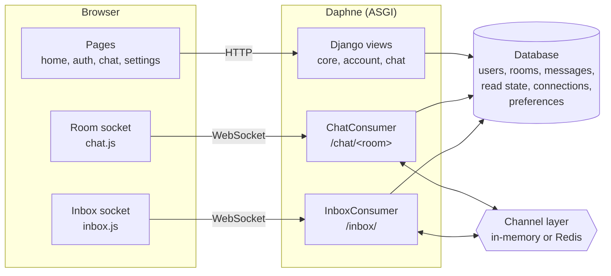
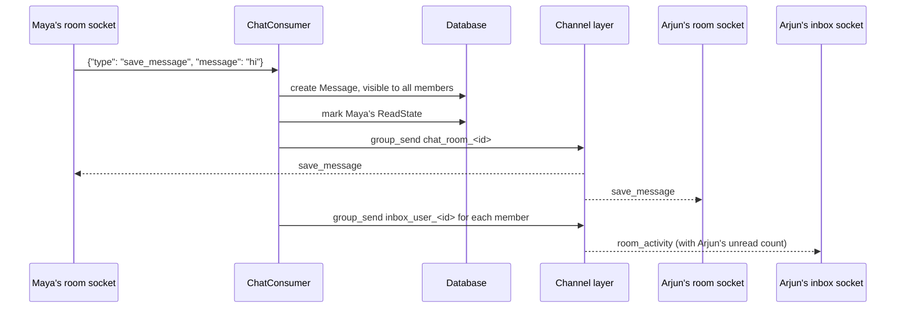

# Architecture

Relay is one Django project served by Daphne (ASGI). Ordinary page requests
go through Django views; live features go through two Channels WebSocket
consumers. All state lives in the database; the channel layer only carries
messages between processes.

## Apps

| App | Responsibility | Key files |
| --- | --- | --- |
| `core` | Design system, base template, theme options, home page, error pages, style guide | `theme.py`, `context_processors.py`, `static/core/`, `templates/core/` |
| `account` | Sign in, create account, sign out, settings, saved appearance | `forms.py`, `views.py`, `models.py` (`Preference`) |
| `chat` | Rooms, messages, chat screen, starting chats, history, presence, unread | `models.py`, `views.py`, `services.py`, `presenters.py`, `presence.py`, `channels/consumers.py` |
| `realtime_chat` | Settings, URL and WebSocket routing, ASGI/WSGI entry points | `settings.py`, `urls.py`, `asgi.py` |

Inside `chat`, each module has one job:

| Module | Job |
| --- | --- |
| `services.py` | Create rooms: people search, direct chats, groups |
| `groups.py` | Group rules: add, remove, rename, admins, leave, delete; writes group events |
| `realtime.py` | Channel layer group names and helpers for sending to room and inbox sockets from views |
| `presenters.py` | Turn rooms and messages into plain data for templates, JSON and sockets |
| `presence.py` | Online status (`Connection`) and unread counts (`ReadState`) |
| `views.py` | HTTP: chat page, people search, start chats, history pages, Details panel, group actions |
| `channels/consumers.py` | WebSockets: `ChatConsumer` (one room) and `InboxConsumer` (everything else) |

## Request flow

### Opening a room

1. `GET /chat/?room=<uuid>` checks membership (404 otherwise), marks the room
   read and renders the page with the latest 50 messages and the room list
   (previews, unread counts) embedded as JSON.
2. `chat.js` draws the transcript from that JSON, then opens the room socket.
   `inbox.js` opens the inbox socket.
3. Scrolling to the top fetches `GET /chat/rooms/<uuid>/messages/?before=…`.

### Sending a message

Edits and deletes follow the same path and broadcast `message_updated`.
Typing events go only to the room group. See
[websocket-protocol.md](./websocket-protocol.md) for every frame.

### Presence

Each inbox socket stores a `Connection` row and pings every 30 seconds. A user
is online while one of their connections was seen in the last 90 seconds.
When a user's first connection opens or last one closes, everyone who shares
a room with them gets a `presence` frame. Because this lives in the database,
it works across several Daphne processes, and connections from a crashed
process simply expire.

## Security model

| Concern | Where it's handled |
| --- | --- |
| Signed-in only | `login_required` on views; consumers close with `4401` for anonymous users |
| Room membership | Views look rooms up through `request.user.rooms`; `ChatConsumer` checks membership on connect **and on every frame**, and removal or deletion closes open sockets (`4403`/`4404`) |
| Group permissions | `chat/groups.py` checks admin rights server-side for rename, remove, admin changes and delete; the panel only hides controls |
| Message ownership | Edit and delete only match the sender's own, undeleted, non-system messages |
| Cross-site WebSockets | `AllowedHostsOriginValidator` checks the `Origin` header against `ALLOWED_HOSTS` |
| XSS | Templates autoescape; scripts build messages with text nodes, never `innerHTML`; initial data uses `json_script` |
| CSRF | Django's middleware; theme saves send the token from `<meta name="csrf-token">` |
| Open redirects | The login `next` parameter must be same-site |
| Secrets | Read from the environment; a secret key is required when debug is off |

## Front end

No build step. Each screen has one stylesheet and at most two scripts, all
plain CSS and JavaScript:

| Layer | Files |
| --- | --- |
| Tokens and components | `core/static/core/css/tokens.css`, `relay.css` |
| Theme | `core/static/core/js/theme.js` plus an inline script in `core/base.html` that applies the theme before first paint |
| Screens | `core/css/home.css`, `account/css/auth.css`, `account/css/settings.css`, `chat/css/chat.css` |
| Behaviour | `account/js/auth.js`, `chat/js/chat.js`, `chat/js/inbox.js`, `chat/js/new-chat.js` |

The only external resource is Google Fonts (Sora, Manrope, JetBrains Mono),
each with a system-font fallback. See [design-system.md](./design-system.md).

## Scaling notes

- Use Redis (`REDIS_URL`) for the channel layer as soon as more than one
  process serves WebSockets.
- All processes must share one database; SQLite suits a single host, so use
  PostgreSQL beyond that (only `DATABASES` needs changing).
- History is paged and room lists are built with a fixed number of queries,
  so page cost does not grow with message count. Unread counts use one
  grouped query per page load and one count per inbox notification.
