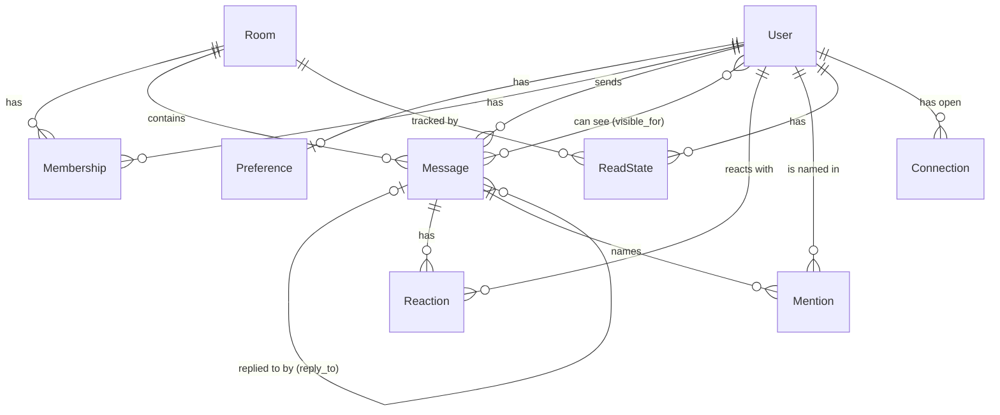

# Data model

## `auth.User`

Django's built-in user model. `username` follows the
[username rules](./screens.md#username-rules) (enforced by the signup form and
applied to older accounts by migration `account/0002_conform_usernames`).
`first_name`, `last_name` and `email` are edited in Settings → Profile.

## `chat.Room`

| Field | Notes |
| --- | --- |
| `id` | UUID primary key; used in URLs and the WebSocket path |
| `name` | Up to 50 characters. Groups show it as the title; private rooms show the other person's name instead |
| `type` | `private` (exactly two members, one per pair of people) or `group` |
| `members` | Many-to-many to `User` (`user.rooms`) through `Membership` |
| `created_at` | Set on creation |
| `created_by` | The group's creator (null for direct chats, or if the account is deleted) |

Rooms are created by `chat/services.py`: `get_or_create_direct_room` and
`create_group_room`. Group changes go through `chat/groups.py`.

## `chat.Membership`

| Field | Notes |
| --- | --- |
| `room`, `user` | Unique together (`room.memberships`, `user.memberships`) |
| `is_admin` | Admins can rename, remove members, change admins and delete the group |
| `joined_at` | When they joined; decides who becomes admin when the last admin leaves |

Stored in `chat_room_members`, the table Django first created for
`Room.members`. Migration `chat/0004_group_admins` adopted it without copying
rows, then made each existing group's earliest-added member its admin and
creator.

## `chat.Message`

| Field | Notes |
| --- | --- |
| `id` | UUID primary key |
| `content` | Text, 1 to 4000 characters after trimming (enforced by the consumer) |
| `kind` | `text`, or `system` for group events written by the server |
| `room`, `user` | Where and by whom |
| `created_at` | Set on creation; messages are ordered by it (indexed with `room`) |
| `edited_at` | Set when the author edits the text |
| `deleted_at` | Set when the author deletes it; `content` is emptied at the same time |
| `visible_for` | Members who can still see the message. Set to all room members on send; **Clear history** removes the requesting user |
| `reply_to` | The message this one replies to, or null. Foreign key to `Message` (`message.replies`), `on_delete=SET_NULL`, indexed. Never changed by an edit |
| `mentions` | Members named with `@username` in the text. Many-to-many to `User` (`user.mentioned_in`) through [`Mention`](#chatmention); no column of its own |

One check constraint, `message_reply_valid`, guards replies:
`reply_to` is null, or the message is a `text` message and doesn't reply to
itself. The consumer also checks that the original is in the same room, is a
text message, isn't deleted and is visible to the sender (see
[the protocol](./websocket-protocol.md#save_message)).

Quotes are live: the reply stores only the original's id, never a copy of its
text. Each time a reply is shown, the server reads the original and builds the
quote for that viewer: its author and an excerpt of its current text, "Message
deleted" once the original is deleted, or nothing but the id for a viewer who
can't see the original. If the original row is removed from the database, the
reply's `reply_to` becomes null and it shows as a plain message. A deleted
reply shows no quote.

Migration `chat/0005_message_reply_to` adds the field and the constraint. It
needs no data migration.

`chat/presenters.py: message_data` turns a message into the JSON shape used by
the page and the socket.

## `chat.Reaction`

One person's emoji on one text message. A person can add several emoji to a
message, but only one of each.

| Field | Notes |
| --- | --- |
| `message` | Foreign key to `Message` (`message.reactions`), `on_delete=CASCADE`. No separate index: the unique constraint starts with `message` |
| `user` | Foreign key to `User` (`user.reactions`), `on_delete=CASCADE` |
| `emoji` | One of the six `ReactionEmoji` keys, up to 16 characters. The key is stored, never the character |
| `created_at` | Set on creation; reactions are ordered by it (then `id`) |

`ReactionEmoji` (in `chat/models.py`) is the fixed set, in display order. Its
label is the emoji character; the names used in labels and tooltips live in
`chat/presenters.py: REACTION_NAMES`.

| Key | Character | Name |
| --- | --- | --- |
| `thumbs_up` | 👍 | Thumbs up |
| `heart` | ❤️ | Heart |
| `laugh` | 😂 | Laughing |
| `wow` | 😮 | Surprised |
| `sad` | 😢 | Sad |
| `party` | 🎉 | Party |

Two constraints:

- `unique_reaction`: one row per `message`, `user` and `emoji`.
- `reaction_emoji_valid`: `emoji` is one of the six keys.

Reactions stay when the person who reacted leaves the room, is removed or
clears their history (after clearing, they can no longer change a reaction on
a message they cleared). Deleting a message removes its reactions in the same
transaction. Deleting the user, or removing the message row, removes them
through the cascade. Only text messages can have reactions; system and
deleted messages never do.

`chat/presenters.py: reactions_for_messages` builds the `reactions` list of
every message object (see
[the protocol](./websocket-protocol.md#reactions-and-the-reactions-list)) for
a page of messages in one query.

Migration `chat/0006_reaction` creates the table and its constraints. It
changes no data and can be reversed.

## `chat.Mention`

One member named with `@username` in one text message.

| Field | Notes |
| --- | --- |
| `message` | Foreign key to `Message` (`message.mention_rows`), `on_delete=CASCADE`. No separate index: the unique constraint starts with `message` |
| `user` | Foreign key to `User` (`user.mention_rows`), `on_delete=CASCADE` |

One constraint, `unique_mention`: one row per `message` and `user`.
`Message.mentions` reaches the same rows as a many-to-many field.

`chat/mentions.py` finds mentions in the text when the message is saved, in
the same transaction:

- A mention is `@` followed by a candidate's exact username. Candidates are
  the room's current members other than the author. Anyone else (yourself,
  an unknown name, a non-member, someone who left) stays plain text, and the
  author isn't told.
- Case doesn't matter: both sides are compared with `casefold()`, so
  `@MAYA` names `maya`.
- The `@` must not follow a letter, digit or underscore, so `x@maya`
  names nobody. The username must not run on into a longer word or handle:
  `@mayabee` and `@lee.chen` don't name `lee`, but `@lee,` and `@lee.` do.
- Where two usernames both fit at the same `@` (`lee` and `lee.chen`), the
  longer one wins.
- Each person counts once per message, in order of their first mention.
- Only the first 200 eligible `@` signs of a message are looked at, so a
  message made of `@` signs costs no more than a normal one.

Usernames are matched directly rather than with a username pattern, so
accounts made with `createsuperuser` (which may contain `@`, `+` or `.`) can
be mentioned too.

When the author edits the text, the mentions are worked out again against
the current members other than the author, and rows are added or removed to
match. Who has cleared their history isn't consulted, so the edit can't tell
the author who did. An unchanged edit keeps the rows as they are. Deleting a
message removes its mentions in the same transaction, as with reactions.
**Clear history** leaves the rows alone: a Mention records what the text
says, so the author's view of their own message never changes when someone
clears (which would reveal who did). Everything that is "for you" (the "@"
count, `for_you`, and anything added later such as notifications) also
requires the message to be in your `visible_for`, so cleared messages never
count or surface for you. Deleting the user, or removing the
message row, removes them through the cascade. Direct chats store mentions
too, but they never count towards the "@" badge.

`chat/presenters.py: mentions_for_messages` builds the `mentions` list of
every message object (see
[the protocol](./websocket-protocol.md#mentions-and-the-mentions-list)) for a
page of messages in one query.

Migration `chat/0007_mention` creates the table with its constraint. It adds
`Message.mentions` to the model state only
(`SeparateDatabaseAndState`): the field has no column, and adding it as a
normal field would make SQLite rebuild the whole `chat_message` table. It
fills in nothing for older messages (they show no mentions) and can be
reversed.

## `chat.ReadState`

| Field | Notes |
| --- | --- |
| `user`, `room` | Unique together |
| `last_read_at` | Messages from others after this are unread. No row means everything from others is unread |

Updated when the user opens the room, sends a `read` frame, or sends a
message. `chat/presence.py: unread_and_mentions` counts, for many rooms in one
grouped query, the unread messages (text messages from others after
`last_read_at` that you can see and that aren't deleted) and how many of
those are "for you": they mention you or reply to one of your messages that
you can still see (groups only). Each room's `last_read_at` comes from a correlated subquery. Both
counts stop at 100 per room. `unread_counts` returns just the unread part.
There is no separate read state for mentions: reading the room clears both.

## `chat.Connection`

| Field | Notes |
| --- | --- |
| `channel_name` | The inbox socket's channel; unique |
| `user` | Whose socket it is |
| `created_at`, `last_seen` | `last_seen` is refreshed by the 30-second ping |

A user is online while any connection has `last_seen` within 90 seconds.
Rows older than an hour are removed when anyone connects.

## `account.Preference`

| Field | Values | Default |
| --- | --- | --- |
| `user` | One-to-one (`user.preference`) | |
| `palette` | `graphite`, `midnight`, `slate`, `plum`, `moss`, `paper` | `graphite` |
| `mode` | `light`, `dark`, `system` | `system` |
| `density` | `compact`, `comfortable` | `compact` |
| `updated_at` | Set on save | |

A row is created the first time a user saves an appearance choice (or picks a
palette during signup). `Preference.for_user(user)` returns the saved row or an
unsaved one holding the defaults.
