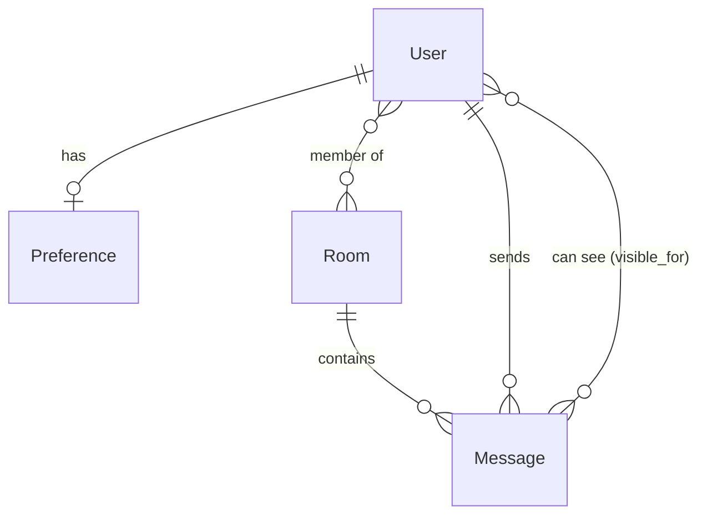

# Data model

## `chat.Room`

| Field | Notes |
| --- | --- |
| `id` | UUID primary key; used in URLs and the WebSocket path |
| `name` | Up to 50 characters. Groups show it as the title; private rooms show the other person's name instead |
| `type` | `private` (exactly two members, one per pair of people) or `group` |
| `members` | Many-to-many to `User` (`user.rooms`) |
| `created_at` | Set on creation |

Rooms are created by `chat/services.py`: `get_or_create_direct_room` and
`create_group_room`.

## `chat.Message`

| Field | Notes |
| --- | --- |
| `id` | UUID primary key |
| `content` | Text, 1 to 4000 characters after trimming (enforced by the consumer) |
| `room`, `user` | Where and by whom |
| `created_at` | Set on creation; messages are ordered by it (indexed with `room`) |
| `edited_at` | Set when the author edits the text |
| `deleted_at` | Set when the author deletes it; `content` is emptied at the same time |
| `visible_for` | Members who can still see the message. Set to all room members on send; **Clear history** removes the requesting user |

`chat/presenters.py: message_data` turns a message into the JSON shape used by
the page and the socket.

## `account.Preference`

| Field | Values | Default |
| --- | --- | --- |
| `user` | One-to-one (`user.preference`) | |
| `palette` | `graphite`, `midnight`, `slate`, `plum`, `moss`, `paper` | `graphite` |
| `mode` | `light`, `dark`, `system` | `system` |
| `density` | `compact`, `comfortable` | `compact` |
| `updated_at` | Set on save | |

A row is created the first time a user saves an appearance choice (or picks a
palette during signup). `Preference.for_user(user)` returns the saved row or an
unsaved one holding the defaults.
